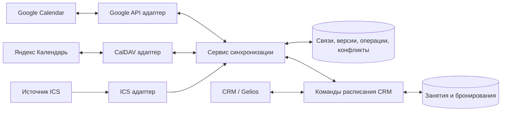

# Синхронизация расписания студии с внешними календарями

Дата: 16 октября 2026 года. Статус: проект архитектуры, без реализации и развёртывания.

## Цель и согласованный сценарий

Создавать и редактировать тренировки в CRM / Gelios и внешнем календаре, автоматически синхронизируя расписание в обе стороны. Первый выбранный провайдер — Google Calendar. Архитектура должна допускать Яндекс Календарь через CalDAV.

Рекомендуется выделенный календарь «Тренировки KATfit». Подключение личного календаря со всеми встречами требует явного отбора событий и не является сценарием по умолчанию.

CRM хранит занятия, бронирования, посещения и финансовую историю. Внешний календарь позволяет редактировать расписание; действия с последствиями для клиентов проходят через команды CRM.

## Ссылка на календарь и способы подключения

Единое поле «Ссылка на календарь» возможно как точка входа, но возможности подключения зависят от типа ссылки и прав доступа.

| Способ | Чтение | Запись обратно | Авторизация |
| --- | --- | --- | --- |
| Обычная ссылка на веб-страницу календаря | Не гарантировано | Не гарантировано | Зависит от сервиса |
| Подписка iCal / ICS / webcal | Да, если источник доступен | Нет | Публичная или секретная ссылка, иногда отдельная авторизация |
| Google Calendar API | Да | Да, при достаточных правах | OAuth |
| CalDAV, включая Яндекс | Да | Да, при достаточных правах | Способ зависит от сервиса |

ICS — универсальный формат обмена. Подписка по URL позволяет регулярно получать расписание из Google, Яндекса и других совместимых источников. Разовая загрузка файла ICS — только снимок, без последующей синхронизации.

Ссылка ICS не даёт права редактирования источника. Для двустороннего режима нужна авторизация через API или CalDAV. Секретную ссылку ICS следует хранить как секрет и не выводить в журнал.

Предлагаемый интерфейс подключения:

1. «Google Calendar» — вход через Google и выбор доступного календаря.
2. «Яндекс / CalDAV» — сервер, логин, пароль приложения и выбор календаря.
3. «По ссылке ICS» — универсальный импорт с явной подписью «Только из календаря в CRM».

Возможность вставить ссылку для определения провайдера — улучшение интерфейса, а не замена авторизации. Неизвестный URL нельзя автоматически считать ICS или CalDAV.

## Google и Яндекс: сложность и существующие компоненты

В репозитории есть драйвер Google Calendar с incremental sync и драйвер CalDAV с чтением событий, sync tokens и ETag. Это основа для переиспользования, а не готовая двусторонняя синхронизация тренировок. Работоспособность с конкретным аккаунтом Яндекса не проверялась.

Исходные точки для технического обследования:

- `packages/twenty-server/src/modules/calendar/calendar-event-import-manager/drivers/google-calendar/`
- `packages/twenty-server/src/modules/calendar/calendar-event-import-manager/drivers/caldav/`
- `packages/twenty-server/src/modules/connected-account-sync-webhooks/`
- `packages/twenty-server/src/modules/connected-account/webhook-subscription-manager/`
- `packages/twenty-apps/internal/katfit-studio/src/objects/class-session.object.ts`

Google API предоставляет специализированные возможности синхронизации и уведомления об изменениях. Для Яндекса официальный путь — CalDAV, сервер `https://caldav.yandex.ru`, логин и отдельный пароль приложения для календаря. Базовое подключение Яндекса не требует создания собственного Google OAuth-приложения.

Для Яндекса первоначально проектируется периодическая проверка изменений. Поддержку эффективных sync reports, удалений и особенностей повторений нужно проверить на тестовом календаре. Нельзя переносить предположения о Google push-уведомлениях на CalDAV.

Google также поддерживает CalDAV, но требует OAuth. Общий протокол не устраняет различия авторизации и возможностей серверов. Предпочтительная схема — общий сервис синхронизации, Google API адаптер и CalDAV адаптер для Яндекса.

Готовый транспортный коннектор решает доступ к событиям. Привязка к ClassSession, отмена бронирований, конфликты и предотвращение дублей остаются логикой студии. Коннектор календаря в ассистенте также не заменяет постоянно работающую серверную интеграцию CRM.

## Пользовательские потоки

### Первое подключение

1. Подключить аккаунт или источник ICS.
2. Выбрать календарь, часовой пояс и правила определения метаданных.
3. Получить предпросмотр: новые занятия, возможные совпадения, неполные события и ошибки.
4. Явно связать существующие занятия; совпадение названия и времени — подсказка, не автоматическая идентичность.
5. Подтвердить импорт и включить фоновую синхронизацию.

### Создание во внешнем календаре

1. Пользователь задаёт название, начало, окончание и при необходимости повторение.
2. Адаптер получает изменение, сервис находит правила группы / календаря.
3. При достаточных данных команда CRM создаёт PLANNED-занятие и журнал операции.
4. При недостаточных данных событие попадает в «Требует уточнения», без создания некорректной тренировки.
5. Сервис сохраняет связь внешнего события и занятия.

Прошедшие события первоначального импорта не превращаются автоматически в проведённые занятия и не создают списания. Политика их импорта требует отдельного решения.

### Создание в CRM

CRM сохраняет занятие и надёжное намерение отправить событие. Фоновый обработчик создаёт событие и сохраняет связь. Пользователь видит «Синхронизируется», «Синхронизировано» или ошибку с возможностью повтора.

### Перенос

Начало и окончание обновляются вместе. При переносе сохраняется идентичность занятия и связанные бронирования. Проверяются длительность, закрытие занятия и ограничения ресурсов, когда такие ресурсы появятся в модели.

Правила уведомления клиентов и подтверждения существенного переноса нужно определить отдельно. До этого автоматическая синхронизация не обещает отправку уведомлений.

## Владелец данных

| Данные | Правило |
| --- | --- |
| Название, начало, окончание | Двустороннее редактирование |
| Место | Двустороннее после введения структурированного поля CRM |
| Формат, группа, вместимость | CRM; для новых внешних событий — правила сопоставления |
| Бронирования и участники | Команды CRM; attendees календаря не являются записью на занятие |
| Посещения, абонементы, оплаты | CRM |
| Подтверждение проведения | CRM; истечение времени события ничего не списывает |
| Отмена | Бизнес-команда CRM с обработкой бронирований |

Вместимость ниже уже забронированного количества нельзя применять автоматически. Смена формата при существующих бронированиях требует бизнес-проверок.

## Метаданные занятий

Приоритет определения: уже сохранённая связь → привязка серии к постоянной группе → явные метаданные → настройки календаря → ручное уточнение. Противоречивые данные требуют уточнения.

Пример пользовательских метаданных в описании:

```text
KATFIT:
group=morning-pilates
capacity=6
```

Идентификатор группы должен быть устойчивым и однозначным внутри workspace. Переименование группы не меняет связь. Название события не используется как первичный ключ.

Техническая связь хранится в базе интеграции. Google extended properties могут дублировать sessionId для восстановления. Для CalDAV возможность сохранения собственных X-свойств проверяется отдельно; корректность интеграции не должна от неё зависеть.

При редактировании сохраняются пользовательское описание и неизвестные интеграции поля события. Личные данные клиентов и сведения об оплате в общий календарь по умолчанию не выгружаются.

## Архитектура



Адаптеры переводят данные провайдера в общий контракт и объявляют возможности: чтение, запись, повторения, версии, уведомления. Сервис синхронизации не содержит условий авторизации конкретного провайдера.

Создание, перенос и отмена проходят через одни и те же команды CRM для UI и интеграции. Календарные calendarEvents Twenty и занятия ClassSession имеют разный смысл; нужен явный слой преобразования.

### Хранимые сущности

- Подключение: workspace, провайдер, выбранный календарь, часовой пояс, ссылка на зашифрованные credentials, режим и возможности, cursor, состояние подписки, время успешной сверки.
- Связь: подключение, внешний event ID / UID, идентификатор серии и экземпляра, ClassSession ID, внешняя версия / ETag, последнее согласованное состояние, признак удаления.
- Операция: направление, объект, ожидаемая версия, idempotency key, состояние, число попыток, следующая попытка, ошибка.
- Конфликт: базовая версия, изменения обеих сторон, причина, решение и оператор.

Уникальность связи обеспечивается ограничением базы по подключению и устойчивой идентичности внешнего экземпляра. Внешние идентификаторы всегда учитываются в контексте аккаунта и календаря.

## Надёжность и конфликты

- Повторная доставка изменения не создаёт второе занятие или событие.
- Собственные записи распознаются по согласованному состоянию и версиям, не по короткому временному окну.
- Изменения обрабатываются последовательно для одной связи, с проверкой ожидаемой версии перед записью.
- Независимые изменения полей объединяются; конкурирующие изменения времени показываются оператору.
- Запись во внешний сервис выполняется с условием версии, если провайдер поддерживает такую возможность.
- Ошибки временной недоступности повторяются с задержкой; отзыв доступа требует переподключения и не отменяет занятия.
- Нужна надёжная запись намерения синхронизации: транзакционный outbox там, где доступна общая транзакция, либо явный протокол восстановления и периодическая сверка. Существующие SDK-команды не следует считать транзакционными без проверки.
- Cursor продвигается после надёжного сохранения полученных изменений / заданий, чтобы сбой бизнес-команды не потерял событие.

Google webhook — сигнал получить изменения, а не готовое тело изменённого события. Нужны продление подписок и периодическая сверка. При недействительном sync token перечитывается внешнее состояние; история и ClassSession не очищаются.

Целевая задержка для Google — порядка минуты при штатной работе, как предварительная цель, не гарантия. Для CalDAV / ICS задержка зависит от интервала опроса и обновления источника; интервал выбирается после проверки ограничений сервиса.

## Повторяющиеся события

Один конкретный экземпляр тренировки соответствует одному ClassSession. Серия задаёт расписание будущих экземпляров, например на восемь недель; горизонт автоматически продлевается. Восемь недель — предлагаемая настройка, не согласованное требование.

Для экземпляра сохраняется исходная идентичность повторения: у Google — серия и originalStartTime; у iCalendar — UID и RECURRENCE-ID с корректным учётом TZID. Перенос экземпляра не создаёт новое занятие.

Обрабатываются отдельный перенос, отдельная отмена, изменение будущей части серии и разделение серии провайдером. Проведённые и закрытые занятия не переписываются. Перед массовыми изменениями нужен предпросмотр последствий.

Время хранится как момент UTC и исходный IANA-часовой пояс для повторений. Начальная настройка студии — Europe/Moscow. События на весь день требуют ручного уточнения времени.

Горизонт создания занятий отделён от cursor синхронизации. Фильтры incremental sync должны соответствовать ограничениям провайдера; сдвигать окно без корректного перечитывания нельзя.

## Отмена и исчезновение событий

| Ситуация | Действие |
| --- | --- |
| Подтверждённое удаление будущего события без записей | Отмена занятия с сохранением истории |
| Подтверждённое удаление события с записями | Запрос подтверждения в CRM, затем отмена бронирований и возврат резервов |
| Проведённое / закрытое занятие | Сохранение истории, расхождение на проверку |
| Нет доступа или календарь недоступен | Ошибка подключения, расписание сохраняется |
| Событие отсутствует в ICS | Проверка полноты источника; отсутствие не считается доказательством отмены |

До подтверждения отмены с участниками связь получает состояние «Ожидает решения». Обратная отправка не должна немедленно воссоздавать удалённое событие. Действие «Сохранить занятие» отдельно разрешает восстановление события.

В режиме ICS изменения управляемых расписанием полей в CRM блокируются либо требуют явного отвязывания занятия. Иначе следующий импорт мог бы незаметно стереть ручную правку.

## Безопасность подключения

Credentials и секретные ICS-ссылки хранятся на сервере в зашифрованном виде, не передаются в клиентские журналы. Подключения и связи изолированы по workspace. Права на запись проверяются до включения двустороннего режима.

Для пользовательских URL нужны защита от SSRF, проверка перенаправлений и разрешённых сетевых адресов, ограничения времени, размера ответа и объёма разворачивания повторений. Удаление подключения прекращает синхронизацию, сохраняя занятия и историю.

## Этапы

1. Обследовать имеющиеся Google / CalDAV компоненты, права и границы транзакций. На тестовых календарях проверить чтение, запись, перенос, удаление, повторения и сохранение метаданных.
2. Ввести команды изменения расписания, связи, очередь, журнал и экран состояния. Реализовать двусторонний Google-сценарий для одиночных занятий.
3. Добавить повторения и безопасную отмену с бронированиями. Это необходимо до полноценного использования регулярного расписания.
4. Подключить Яндекс через CalDAV к тем же бизнес-командам; подтвердить совместимость отдельными интеграционными проверками.
5. При необходимости добавить универсальный ICS-импорт как отдельный режим чтения.

Приоритет Google выбран пользователем. Если основным рабочим календарём станет Яндекс, после технической проверки можно поменять порядок адаптеров без изменения бизнес-архитектуры.

## Критерии приёмки

- Создание и перенос с каждой стороны сходятся к одному занятию и одному внешнему событию.
- Повтор, потерянный ответ и перезапуск не создают дублей и не теряют изменения.
- Конкурирующие переносы не затираются без решения оператора.
- Отмена с клиентами не теряет бронирования и резервы; история сохраняется.
- Прошедшее время не запускает посещение или списание.
- Перенос экземпляра серии сохраняет его участников и идентичность.
- Потеря доступа, неполный ICS и смена cursor не вызывают массовую отмену.
- Пользователь видит последнее успешное обновление, ошибки и ожидающие решения.

## Вопросы перед реализацией

1. Требуется ли Яндекс уже в первом выпуске или после Google?
2. Кто может подключать календарь и разрешать конфликты?
3. Нужно ли подтверждение переноса занятия с участниками и какие уведомления отправлять?
4. Какие группы и форматы используются по умолчанию, каков горизонт публикации?
5. Как обрабатывать существующие прошлые события и массовые изменения серий?

## Источники и связанная документация

Проверено 16 октября 2026 года:

- [Google: iCal-ссылка даёт режим чтения](https://support.google.com/calendar/answer/37648?hl=en).
- [Яндекс: экспорт событий](https://yandex.ru/support/yandex-360/customers/calendar/web/ru/export).
- [Яндекс: CalDAV, сервер и пароль приложения](https://yandex.ru/support/yandex-360/customers/calendar/web/ru/data-exchange/synchronization/sync-desktop).
- [Google: CalDAV и OAuth](https://developers.google.com/workspace/calendar/caldav/v2/guide).
- [Google: incremental sync](https://developers.google.com/workspace/calendar/api/guides/sync).
- [Google: push notifications](https://developers.google.com/workspace/calendar/api/guides/push).
- [Google: extended properties](https://developers.google.com/workspace/calendar/api/guides/extended-properties).
- [Google: повторяющиеся события](https://developers.google.com/workspace/calendar/api/guides/recurringevents).
- [Gelios: календарь и участники](gelios-calendar-integration.ru.md).
- [Gelios: создание занятий](gelios-session-creation.ru.md).

Наличие компонентов в исходниках не подтверждает их развёртывание или совместимость с конкретным аккаунтом. Проверки реальных календарей и изменения CRM в рамках подготовки этого документа не выполнялись.
