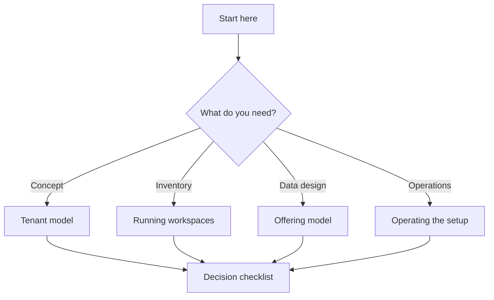

# Guides

🟢 Current · Last reviewed: 2026-10-28

This folder is the building directory for this Twenty instance. One page tells you which floor to visit; the guides explain what happens there.

## How to read

Pick the route that matches the question you are asking. The guides do not need to be read in order.

| Signal | Route | Reader goal |
| --- | --- | --- |
| “How is a country separated?” | [Multi-country tenancy](01-multi-country-tenancy.md) | Understand tenants, switching and isolation |
| “What exists today?” | [What is running now](01-multi-country-tenancy.md#what-is-running-now) | Inventory the live workspaces |
| “How do I model offerings?” | [Offering data model](01-multi-country-tenancy.md#offering-data-model) | Draft objects before building them |
| “How do I add another country?” | [Operating the setup](01-multi-country-tenancy.md#operating-the-setup) | Repeat the setup safely |

## Reading path

## Guide inventory

| Guide | Question it answers | Status |
| --- | --- | --- |
| [Multi-country tenancy](01-multi-country-tenancy.md) | How Twenty separates countries and how to add offerings | 🟢 Implemented |

## Cheat sheet

| Goal | Start point |
| --- | --- |
| Open a country workspace | `http://<subdomain>.localhost:3001` |
| Switch tenant | Workspace menu in the left navigation |
| Add a country | Read “Operating the setup” first |
| Design an offering | Read “Offering data model” first |

_Living index — add a row when a new guide lands._
