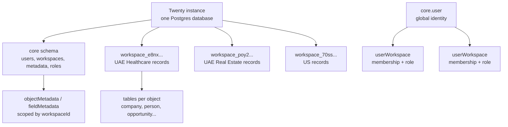
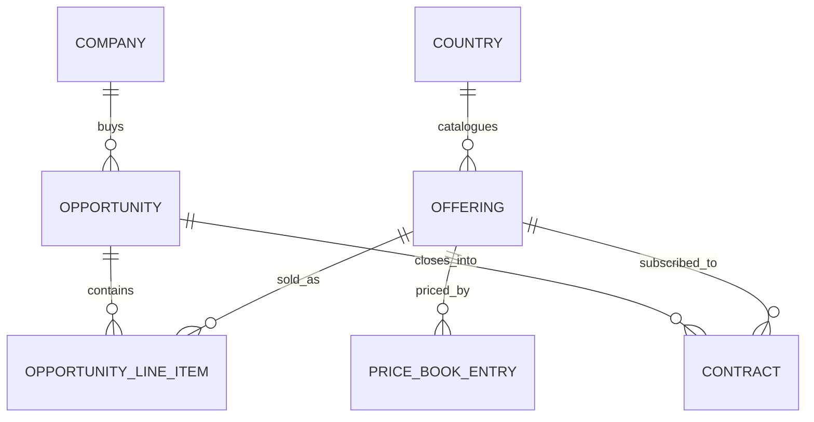

# Multi-country tenancy and the Twenty data model

🟢 Implemented locally · Last reviewed: 2026-10-28 · Scope: `twenty-server`, `twenty-front`

This guide explains how Twenty separates tenants, what the current data model actually is, and how the three live country workspaces — **UAE Healthcare**, **UAE Real Estate** and **US** — are modelled.

## Status legend

Color is supplementary. The text carries the meaning.

| Marker | State | Meaning |
| --- | --- | --- |
| 🟢 | Implemented | Present and working in the local instance |
| 🟡 | Partial | Supported, but with a caveat you must plan around |
| 🔵 | Planned | Not built yet; discussed as the next step |
| ⚪ | Not available | A platform boundary, not a backlog item |

## What, why, how

**📌 In plain English.** Twenty's tenant is the **workspace**. One workspace per country gives each country its own data, users, roles, offering catalogue, API keys and schema.

**Analogy.** Think of country subsidiaries. Each has its own filing room and ledger (the workspace and its Postgres schema), and the same employee can hold keys to several rooms (one user account, several memberships). The workspace menu is the keyring.

**🛠️ What actually happens.** A workspace is a row in `core.workspace` with a unique subdomain and its own `databaseSchema`. Records live in that schema. Object and field metadata are scoped to the workspace. Membership is a row in `core.userWorkspace`, and the user's per-workspace profile is a `workspaceMember` record.

**What you see.** Each country opens on its own URL, for example `http://uae-healthcare.localhost:3001`. The workspace menu lists every workspace the signed-in user belongs to.

> **💡 Why it matters:** A workspace is not a filter or a view. It is the isolation boundary. Country teams cannot see each other's records, and a record in one workspace cannot be related to a record in another.

## Choose your route

| Signal | Route | Reader goal |
| --- | --- | --- |
| “What is a tenant?” | [The tenant model](#the-tenant-model) | Learn the hierarchy and the tables |
| “What exists now?” | [What is running now](#what-is-running-now) | Inventory the live workspaces |
| “What can Twenty not do?” | [Platform boundaries](#platform-boundaries) | Avoid designing into a wall |
| “How should offerings look?” | [Offering data model](#offering-data-model) | Draft the object graph |
| “How do I run this?” | [Operating the setup](#operating-the-setup) | Switch, invite, add a country |
| “What should we decide next?” | [Decision checklist](#decision-checklist) | Prepare the objects discussion |

## The tenant model



### Core entities

| Entity | Location | What it means |
| --- | --- | --- |
| `workspace` | `core.workspace` | The tenant: display name, unique subdomain, custom domain, activation status, `databaseSchema` |
| `user` | `core.user` | Global identity, shared across workspaces |
| `userWorkspace` | `core.userWorkspace` | Membership; unique on `(userId, workspaceId)` |
| `workspaceMember` | Per-workspace schema | The person as a record inside a workspace: name, avatar, locale, timezone, date format, week start |
| `role` / `roleTarget` | `core.role`, `core.roleTarget` | Per-workspace roles, assigned to users, API keys and AI agents |
| `objectMetadata` / `fieldMetadata` | `core` tables | Per-workspace schema definitions; unique object names include `workspaceId` |
| Records | `workspace_<base36>` schema | One table per object, created by the workspace migration runner |

The schema name is derived in `packages/twenty-server/src/engine/workspace-datasource/utils/get-workspace-schema-name.util.ts`:

```ts
export const getWorkspaceSchemaName = (workspaceId: string): string => {
  return `workspace_${uuidToBase36(workspaceId)}`;
};
```

Every workspace gets its own schema when it activates. The activation path is `WorkspaceService.activateWorkspace` → `WorkspaceManagerService.init` in `packages/twenty-server/src/engine/core-modules/workspace/services/workspace.service.ts`.

### Switching workspaces

The server exposes the current user's memberships as `user.availableWorkspaces` (`packages/twenty-server/src/engine/core-modules/user/user.resolver.ts`). The front-end renders them in the workspace menu (`MultiWorkspaceDropdown`) and switches by redirecting to the target workspace URL.

Switching is meaningful only when multi-workspace mode is on:

```bash
IS_MULTIWORKSPACE_ENABLED=true
DEFAULT_SUBDOMAIN=app
```

With it off, `redirectToWorkspaceDomain` returns without navigating and every workspace shares one host (`packages/twenty-front/src/modules/domain-manager/hooks/useRedirectToWorkspaceDomain.ts`). With it on, workspace URLs become `subdomain.<frontend-host>`.

### Permissions

Permissions are workspace-scoped and layered:

1. **Role flags** — read/update/soft-delete/destroy all records, settings access, tools access.
2. **Object permissions** — per-object overrides.
3. **Field permissions** — see/edit/no access; not available on system objects such as `workspaceMember`.
4. **Row-level permissions** — per-role, per-object predicates and AND/OR groups.

> **⚠️ Watch out:** Row-level security is licensed: `hasRowLevelPermissionFeature` requires a valid enterprise plan and the `RLS` entitlement. Country isolation in the workspace-per-country model does not depend on it.

### APIs, apps and metadata

| Surface | What it gives you |
| --- | --- |
| Core API | `/graphql` and `/rest`, generated from each workspace's schema; adding `Offering` immediately exposes it |
| Metadata API | `/metadata` and `/rest/metadata`, for creating and changing objects, fields and relations |
| Authentication | Workspace-scoped API keys, assignable to a role; `Authorization: Bearer <key>` |
| Apps | `twenty-sdk` objects, fields, relations, views, layouts, roles and install hooks, installed per workspace |
| Webhooks | Per workspace, triggered by record changes |

## What is running now

Three workspaces exist in the local database. The seeded Apple and YCombinator demo workspaces, their records and their demo accounts were removed; only the country tenants remain.

| Workspace | Subdomain | Schema | Status | Purpose |
| --- | --- | --- | --- | --- |
| UAE Healthcare | `uae-healthcare` | `workspace_e8nxa8wv4u420rn2m8njybrjd` | 🟢 Active | Healthcare offerings in the UAE |
| UAE Real Estate | `uae-real-estate` | `workspace_poy2pxrtszdkn7q1un3a357` | 🟢 Active | Real-estate offerings in the UAE |
| US | `usa` | `workspace_70ssgf5etd2ja16l94kck3fmt` | 🟢 Active | US offerings |

The US workspace uses subdomain `usa` because `us` is in `RESERVED_SUBDOMAINS` (`packages/twenty-shared/src/constants/ReservedSubdomains.ts`). The display name remains **US**.

### Local configuration

The local `packages/twenty-server/.env` now contains:

```bash
IS_MULTIWORKSPACE_ENABLED=true
DEFAULT_SUBDOMAIN=app
AUTH_COOKIE_ALLOWED_ORIGINS=http://localhost:3001,http://app.localhost:3001,http://uae-healthcare.localhost:3001,http://uae-real-estate.localhost:3001,http://usa.localhost:3001
```

`AUTH_COOKIE_ALLOWED_ORIGINS` is a local-development convenience for the subdomain origins. A real deployment should use its real front-end origins and a wildcard TLS certificate.

### Open the workspaces

| Workspace | URL |
| --- | --- |
| UAE Healthcare | `http://uae-healthcare.localhost:3001` |
| UAE Real Estate | `http://uae-real-estate.localhost:3001` |
| US | `http://usa.localhost:3001` |

Use the prefilled local dev sign-in, or sign in as `karim@klaim.ai`. Both `tim@apple.dev` and `karim@klaim.ai` are **Admin** members of all three workspaces, with one `workspaceMember` record per workspace.

## Platform boundaries

| Boundary | Reality |
| --- | --- |
| Cross-workspace relations | ⚪ Impossible. Records live in separate schemas; APIs are per workspace. |
| Cross-workspace dashboards | ⚪ Not native. Aggregate through the API, a warehouse, or read-only SQL. |
| Shared customers across countries | ⚪ Not linkable across workspaces. Duplicate with a stable external ID, or choose a single-workspace design. |
| Country as a tenant object | ⚪ There is no Country object. A country is a workspace, a field, or a custom object. |
| Product / Offering object | ⚪ Not standard. Create custom objects. |
| Currency conversion | ⚪ `CURRENCY` stores `amountMicros` + `currencyCode`; there is no FX conversion. |
| Data residency per country | ⚪ Workspace schemas share one Postgres database. Residency requires separate instances. |
| Email and calendar sync | 🟡 Only on People, Companies and Opportunities. Keep contacts on those objects. |
| API keys, webhooks, apps | 🟡 Per workspace. Plan one key and one app installation per country. |
| Row-level security | 🟡 Enterprise licence required; not a substitute for workspace isolation. |

## Offering data model

In the workspace-per-country model, the **workspace is the country boundary**. A `Country` relation is only needed if you later consolidate into one workspace.



### Suggested objects

| Object | Key fields | Notes |
| --- | --- | --- |
| `Offering` | `name`, `code`, `category` (SELECT), `description` (RICH_TEXT), `status` (SELECT), `defaultCurrency` (SELECT), `defaultTaxRate` (NUMBER), `billingPeriod` (SELECT), `effectiveFrom`, `effectiveTo`, `owner` | The catalogue item. One record per sellable thing. |
| `PriceBookEntry` | `offering` (M2O), `currencyCode`, `unitPrice` (CURRENCY), `taxInclusive` (BOOLEAN), `effectiveFrom`, `effectiveTo`, optional `minQuantity` | Separates price from the product. |
| `OpportunityLineItem` | `opportunity` (M2O), `offering` (M2O), `quantity`, `unitPrice` (CURRENCY), `discountPercent`, `taxRate`, `lineTotal` (CURRENCY), `billingPeriod` | The offering as sold on a deal. Roll up to `Opportunity.amount` with a workflow. |
| `Contract` / `Subscription` | `company`, `opportunity`, `offering`, `status`, `startDate`, `endDate`, `mrr` / `arr` (CURRENCY), `renewalDate` | Optional, but useful for recurring revenue. |
| `CountrySettings` | `countryCode`, `currencyCode`, `vatRate`, `timezone`, `defaultLocale`, `fiscalYearStart` | Optional single-record object for per-workspace defaults. |

### Extend the standard objects

| Object | Fields to add |
| --- | --- |
| `Company` | `country` (SELECT), `crNumber`, `vatNumber`, `billingAddress` (ADDRESS), `preferredLanguage` |
| `Person` | `country`, `preferredLanguage`, `mobile` |
| `Opportunity` | `country` (denormalised for filtering and reporting), `contractTerm`, line items |

Keep contacts on `Person` and `Company`. Replacing them with a custom “Customer” object loses mailbox and calendar sync.

### Why not one Offering object with every country's fields?

Use a common core plus **country extension objects**. For example, `KsaOfferingDetails` or `AeOfferingDetails` with a many-to-one relation to `Offering`. This keeps the shared reporting model clean while allowing local compliance fields.

> **💡 Why it matters:** In the workspace-per-country design, “different offerings” is naturally expressed as different records, and even different fields, without polluting another country's model. The cost is that the same offering is not one record across countries.

## Operating the setup

### Switch tenant

1. Sign in on any workspace URL.
2. Open the workspace menu in the left navigation.
3. Pick another workspace. The browser navigates to its subdomain and re-authenticates against that workspace.

The menu only shows workspaces where the user has a membership. Group executives who need all countries must be invited to each workspace.

### Add another country

1. Pick a subdomain that is not in `RESERVED_SUBDOMAINS` (for example `ksa`, `oman`, `qatar`).
2. Create the workspace through the create-workspace flow, or call `signUpInNewWorkspace` with a user session.
3. Activate it with `activateWorkspace` so the schema and standard objects are provisioned.
4. Invite the country team and assign roles inside that workspace.
5. Install the shared app or apply the data model in that workspace.
6. Create a workspace-scoped API key if the country needs integrations or ETL.

`IS_WORKSPACE_CREATION_LIMITED_TO_SERVER_ADMINS` defaults to `true` in the server configuration. It is currently `false` locally. Decide deliberately who may create workspaces in production.

### Members and roles

| Need | Action |
| --- | --- |
| Country team | Invite to that workspace only; assign a country role |
| Group executive | Invite to every country workspace; one membership per workspace |
| Integration | Create one API key per workspace; assign a role to the key |
| AI agent | Assign a role to the agent; it inherits that role's object and field access |

Roles are per workspace. A “KSA Sales Manager” role in one workspace is unrelated to a role with the same name in another.

### Reporting across countries

There is no cross-workspace dashboard. Choose one of these:

| Approach | How | Trade-off |
| --- | --- | --- |
| Per-workspace dashboards | Build dashboards inside each country | Simple, but no group roll-up |
| API / warehouse | Pull each workspace with its own API key into a warehouse | Clean, permission-respecting, needs a pipeline |
| Read-only SQL | Query `workspace_*` schemas in the shared database | Fast on self-host, but bypasses permissions and couples to internals |

For financial consolidation, store the currency on every amount and apply FX rates downstream. Twenty does not convert currencies.

### Managing schema drift

Three workspaces edited by hand drift quickly. Prefer a versioned `twenty-sdk` app:

- Declare objects with `defineObject`, fields with `defineField`, relations with `defineRelation`.
- Keep universal identifiers stable across all workspaces.
- Use install hooks to seed country settings and the initial offering catalogue.
- Use per-country extension objects for genuinely local fields.

## Decision checklist

Before adding the offering objects, settle these:

| Question | Why it changes the model |
| --- | --- |
| Do the same customers buy in several countries? | Cross-workspace relations are impossible; shared accounts push you toward one workspace with row-level security. |
| Do KSA or UAE regulations require in-country hosting? | Workspace schemas share one database; residency requires separate instances. |
| Do offerings differ by fields, or only by records and prices? | Only fields justify per-country schema extensions; records do not. |
| Who owns consolidated reporting? | The answer decides between a warehouse pipeline and read-only SQL. |
| Do you need SSO in every country? | SSO is configured per workspace. |
| Which currency is each amount stored in? | `CURRENCY` keeps the code but does not convert. |
| Is the next country KSA, Oman or another market? | Add it with the same create → activate → invite pattern. |

## Cheat sheet

| Goal | Start point | Deep dive |
| --- | --- | --- |
| Understand the tenant boundary | `core.workspace` and `workspace_*` schemas | [The tenant model](#the-tenant-model) |
| See what is live | Workspace table above | [What is running now](#what-is-running-now) |
| Design an offering catalogue | `Offering` → `PriceBookEntry` → `OpportunityLineItem` | [Offering data model](#offering-data-model) |
| Switch country | Left-navigation workspace menu | [Operating the setup](#operating-the-setup) |
| Add a country | Create workspace, activate, invite | [Operating the setup](#operating-the-setup) |
| Consolidate revenue | API or read-only SQL | [Operating the setup](#operating-the-setup) |

## References

| Topic | Source |
| --- | --- |
| Objects, fields and relations | [Data model](https://docs.twenty.com/getting-started/core-concepts/data-model) |
| REST and GraphQL APIs | [APIs](https://docs.twenty.com/developers/extend/api) |
| App objects and relations | [Objects](https://docs.twenty.com/developers/extend/apps/data/objects), [Relations](https://docs.twenty.com/developers/extend/apps/data/relations) |
| Roles and row-level rules | [Permissions](https://docs.twenty.com/user-guide/permissions-access/capabilities/permissions) |
| Workspace entity | `packages/twenty-server/src/engine/core-modules/workspace/workspace.entity.ts` |
| Membership and roles | `packages/twenty-server/src/engine/core-modules/user-workspace/user-workspace.entity.ts`, `packages/twenty-server/src/engine/metadata-modules/role/role.entity.ts` |
| Row-level predicates | `packages/twenty-server/src/engine/metadata-modules/row-level-permission-predicate/entities/row-level-permission-predicate.entity.ts` |
| Schema naming | `packages/twenty-server/src/engine/workspace-datasource/utils/get-workspace-schema-name.util.ts` |

_Living document — update the workspace table and the decision checklist whenever the tenant model or country list changes._
