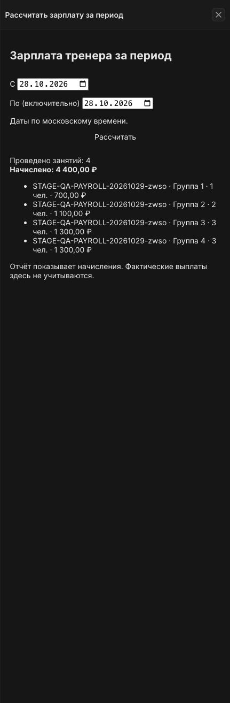

# Зарплата тренеров: выпуск и проверка stage, 29.10.2026

Выпущено только приложение `katfit-studio` на **http://crm-stage.lan**, workspace `65dcede8-ba67-45d1-b4fd-64d9224ab8ca`. Ядро Twenty, внешний UI/API и production не менялись.

## Источник выпуска

Ветка `codex/trainer-compensation`, HEAD `7e6b240d752c9bf54fcd72e2d8b140ffb5bb782a`, рабочие изменения без коммита. Перед выпуском обнаружено, что stage содержит более новую версию приложения: расходы, журнал операций, защищённые команды оплаты и бронирования. Найден и сверён снимок `codex/katfit-application-mcp-fixes` (база `9ff650e8859a78e3cde0b07a61418e273845b19f` с уже развёрнутыми рабочими исправлениями); его исходники приложения сохранены и совмещены с зарплатой. Другие рабочие копии не изменялись.

SHA-256 дерева исходников приложения, скриптов и конфигурации: `810691b0e48d757e5d4f62a63a5644f44ae17edca8e4b2606514d6c2bc719b2c`.

Исходный опасный план с удалением `studioExpense`, `studioSessionOperation` и 52 полей **не применялся**. После совмещения выпуск прошёл с планом **373 добавления / 21 изменение / 0 удалений**, `Synced KATFIT Studio (96 files)`.

Живая проверка выявила возврат пустого nullable TEXT как `""` вместо `null` в `previousEntryId`. Сравнение исправлено, локальная фикстура теперь воспроизводит поведение Twenty. Начисление завершено с тем же ID `26bf4f63-9482-4b60-98ba-235c59429055`, без дубля. Повторный выпуск: **0 / 5 / 0**, 96 файлов. Дополнительно отключено обычное создание и редактирование журнала начислений и технических блокировок в UI.

Финальный plan: **0 / 2 / 0**. Осталась только повторяющаяся нормализация `viewUniversalIdentifier: null` двух FIELDS-виджетов сервером; схема и код функций не требуют обновления. Лишний apply не запускался. Финальный `/healthz`: HTTP 200, `status=ok`.

## Проверки

Локально: прямой `tsgo`, `oxlint` без предупреждений, **298 unit-тестов**. Через MCP Twenty Stage в evidence сохранено **62 вызова**, из них **41 доменный вызов**. Все 41 имеют отдельный `MCP_COMMAND`; пять отказов также зафиксированы. Всего **27 контрольных проверок** успешны. Проверялся реальный stage без подмены сетевых ответов.

| Сценарий | Результат |
| --- | --- |
| Каталог и назначение | Два тренера; неактивный отклонён; назначение активного подтверждено и журналируется |
| Публикация | Отсутствующая четвёртая ступень отклонена; все четыре произвольные суммы опубликованы |
| 1 / 2 / 3 / 4 пришедших | 700 / 1100 / 1300 / 1650 ₽; полная группа не привязана к примеру 1500 ₽ |
| Повтор с другим ключом | Возвращено исходное начисление; расход не удвоился |
| Оплаченная неявка | Четвёртый клиент имеет NO_SHOW и PAID; в расчёте трое, 1300 ₽ |
| Замена фактического тренера | Исходные 1650 ₽ тренеру B, сторно −1650 ₽ B, новое начисление 1300 ₽ A |
| Повтор исправления | Возвращена исходная ревизия; повторного сторно нет |
| Ноль посетивших | Отказ без изменения зарплаты |
| Назначение после закрытия | Отказ; требуется исправление начисления |
| Журнал | Шесть POSTED-операций, итог 4400 ₽; все записи участников и снимки расчёта сохранены |
| Смена версии тарифа | v2 с полной группой 2100 ₽ не меняет ни один из шести исторических снимков |
| Архив тренера | Оба тестовых тренера неактивны; отчёт и история доступны |
| Клиентские данные | 10 оплат PAID и 10 записей сохранены; зарплатное исправление их не отменяет |
| Регресс пакета | Доступно 6 → 5, резерв 0 → 1; штатная отмена вернула 6 / 0, использовано осталось 2 |
| Блокировки | Собственные блокировки зарплаты отсутствуют, `mutationLock` тестовых занятий пуст |
| UI | В видимом внутреннем браузере карточка тренера, вкладки и отчёт: **4 занятия / 4400 ₽**; совпадает с MCP |

Отмена тестовой брони и слота выполнена штатными HTTP-маршрутами приложения, состояние независимо сверено MCP. Прямой `dev:function:exec` был отклонён механизмом аутентификации CLI; он не изменил данные. Защита отмены слота сначала отклонила пустой ожидаемый список, поскольку история содержала отменённую запись; после MCP-сверки передан фактический ID записи, отмена успешна. Журналы вручную не правились.

## Сохранённые тестовые данные

Префикс: `STAGE-QA-PAYROLL-20261029-zwso`. Сохранены для аудита: четыре новых синтетических клиента без контактных адресов, два деактивированных тренера, две версии тарифа, три назначения, четыре проведённых занятия, десять оплаченных разовых посещений и шесть зарплатных операций. Тестовые оплаты — синтетические записи stage, фактических переводов денег не было.

Дополнительное будущее занятие `5eb09efd-a147-48ea-852f-3b2bf8bbcd0e` и бронь `429b4ff5-a268-486b-a353-58e5bf5dceb8` отменены. Использованный ранее синтетический QA-пакет `caa7f6e9-6af2-4934-887c-e25ed51c1709` возвращён в исходное состояние: доступно 6, резерв 0, использовано 2. Идентификаторы остальных записей и полный протокол — в evidence.

Итог зарплаты: тренер A — **4400 ₽ за 4 занятия**, тренер B — **0 ₽**. Начисления не означают фактические выплаты; выплаты отдельным реестром пока не реализованы.

## Границы проверки

Расчёт реализован для групп на реформере с 1–4 посетившими. Персональные занятия, сплиты и оплата при нуле посетивших требуют отдельных правил. Неподтверждённые сетевые сбои не провоцировались на общем stage; соответствующие сценарии проверены локально. Прямой административный CRUD вне команд способен обходить прикладные ограничения, как и в исходной версии; роли workspace автоматически не переназначались.

## Доказательства

- [Полный протокол и ID](evidence.json)
- [Выпуски и финальный plan](release.log)
- [Скриншот отчёта](salary-report.png)

