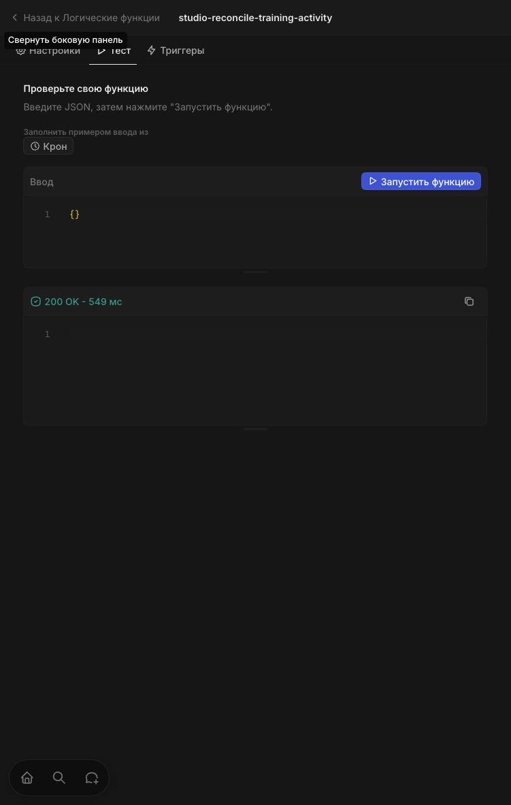

# Автоматические статусы клиентов: stage и production

1 ноября 2026 года. Выпущено приложение KATFIT Studio:
`http://crm-stage.lan` (remote `stage`) и `http://crm.lan` (remote `prod`).

## Результат

Добавлены поле «Активность занятий», обработчики событий записи/занятия и
ежедневный пересчёт в 02:00 UTC (05:00 МСК). Основной «Статус клиента» также
обновляется: `ACTIVE` → `ACTIVE_CLIENT`, `PAUSED` → `PAUSED`.
Для `NOT_STARTED` основной статус сохраняется. Этап сделки не меняется.
Полные правила, включая отмену первой записи: [описание](../training-activity.ru.md).

Оба контура получили код commit `52317bffb5` из ветки
`codex/client-training-activity`, рабочее дерево было чистым. Исходная версия
с отдельным полем активности (`85d0694ae5`) сначала была установлена на stage;
после уточнения пользователя туда выпущена и проверена итоговая синхронизация
основного статуса. Production сразу получил итоговую версию. Изменений исходников
между итоговыми stage/prod apply не было. Этот отчёт и отметки выпуска в документах
добавлены после проверки обоих контуров.

Пользователь подтвердил готовность production-бэкапа в чате перед выпуском.
Дата/ID backup set и восстановление независимо не проверены: Databasus запросил
вход. Доступы и настройки резервного копирования не менялись.

## Планы и применение

| Контур | План до итогового выпуска | Применение | План после |
| --- | --- | --- | --- |
| Stage | 0 добавлений, 5 изменений, 0 удалений: три функции и два виджета | Synced KATFIT Studio (102 files) | 0 добавлений, 2 нормализации виджетов, 0 удалений |
| Production | 7 добавлений, 2 изменения, 0 удалений: поле, три функции, отображение поля | Synced KATFIT Studio (102 files) | 0 добавлений, 2 нормализации виджетов, 0 удалений |

Оставшиеся изменения — известная нормализация `viewUniversalIdentifier: null`
двух FIELDS-виджетов. Неприменённых изменений поля и кода функций нет.
Использован существующий preload ограничения частоты CLI-загрузки; серверная
защита не менялась. Внешние UI/API и контейнеры Twenty не обновлялись.

Доказательства: [stage plan до](stage-plan-before.log), [stage apply](stage-apply.log),
[stage plan после](stage-plan-after.log), [prod plan до](prod-plan-before.log),
[prod apply](prod-apply.log), [prod plan после](prod-plan-after.log).

## Проверки

- Typecheck, lint и 316 unit-тестов приложения прошли; до первого выпуска также
  выполнены `twenty dev:typecheck` и сборка приложения. Каждый apply собирал
  итоговые файлы и выполнял typecheck.
- На stage выполнены реальные REST-изменения синтетических записей и независимые
  чтения Person после асинхронных событий. Проверены будущая запись, исправление
  забытого `CONTACTED` при уже правильной активности, отмена, старое посещение,
  перенос занятия на недавнюю дату и неявка. [Результаты](stage-lifecycle-smoke.log).
- Установленная ежедневная функция stage запущена через авторизованный UI:
  **200 OK, 549 мс**. CLI `dev:function:exec` и попытка metadata-вызова через
  API-ключ отклонены: endpoint требует пользовательский контекст. Права не
  расширялись; проверка через UI завершилась успешно.
- Начальный пересчёт обоих контуров выполнен тем же исходным
  `recomputeTrainingActivity` через штатный CoreApiClient и существующий ключ
  соответствующего remote. Адреса проверялись строго; redirects запрещены.
  Production cron вручную через пользовательский endpoint не запускался.
- После пересчёта независимо прочитаны все страницы Person: нет рассинхрона
  `ACTIVE`/`ACTIVE_CLIENT` и `PAUSED`/`PAUSED`.
- Healthcheck обоих контуров успешен. Наличие всех трёх функций подтверждено
  metadata API: [stage](stage-functions.json), [prod](prod-functions.json).

| Контур | Клиентов | Активен | Приостановлен | Ещё не занимался | Рассинхрон |
| --- | --- | --- | --- | --- | --- |
| Stage | 47 | 8 | 3 | 36 | 0 |
| Production | 76 | 23 | 2 | 51 | 0 |

Сводки: [stage](stage-backfill-summary.json), [prod](prod-backfill-summary.json).
Новые статусы не требуют ожидания следующего ежедневного запуска.

## Сверка production

Сравнены обезличенные SHA-256 снимков выбранных полей до выпуска и после
пересчёта. Совпали:

- 66 сделок: ID и `clientStage`;
- 42 пакета: ID, статус, владелец, начисленные/зарезервированные/списанные/доступные посещения;
- 42 оплаты: ID, статус, сумма/валюта оплаты и возврата;
- 104 операции пакетов: ID, тип, изменение посещений;
- 40 начислений тренерам: ID, состояние, тип, сумма/валюта.

Число клиентов осталось 76; их основные статусы ожидаемо изменились.
Снимки содержат только количества и контрольные суммы, без имён и финансовых
значений: [до](prod-before-snapshot.json), [после](prod-after-snapshot.json).
Проверка не означает сверку каждого поля всех объектов. Финансовые операции
и синтетические клиенты в production не создавались. Вход в production UI
не выполнялся: показан экран авторизации; проверки production проведены API/CLI.

## Синтетические данные stage

Сохранены один клиент `STAGE-QA-ACTIVITY-8d53ace708`, одно занятие и одна запись.
[Идентификаторы](stage-fixture.json). Занятие и запись отменены студией;
активность `NOT_STARTED`, основной статус `ACTIVE_CLIENT` сохраняется согласно
правилу отмены первой записи. Платежи, пакеты, списания и начисления для этого
теста не создавались. История проверки не удалялась.

Откат не выполнялся. Возврат к старому коду сам по себе не восстанавливает
основные статусы, изменённые начальным пересчётом.

