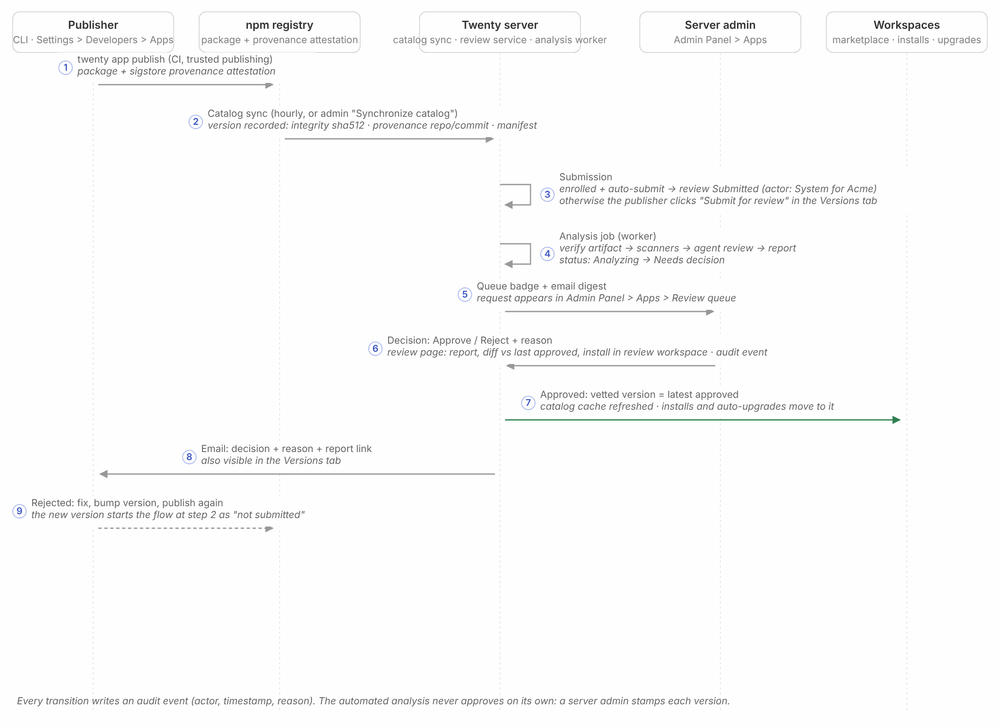
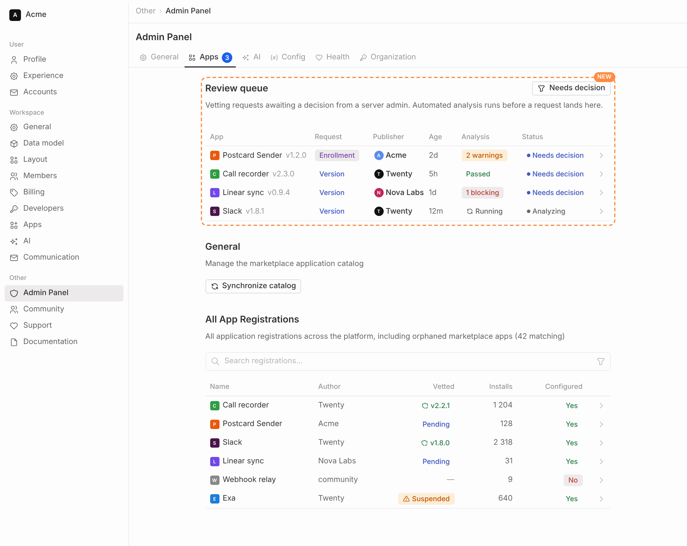
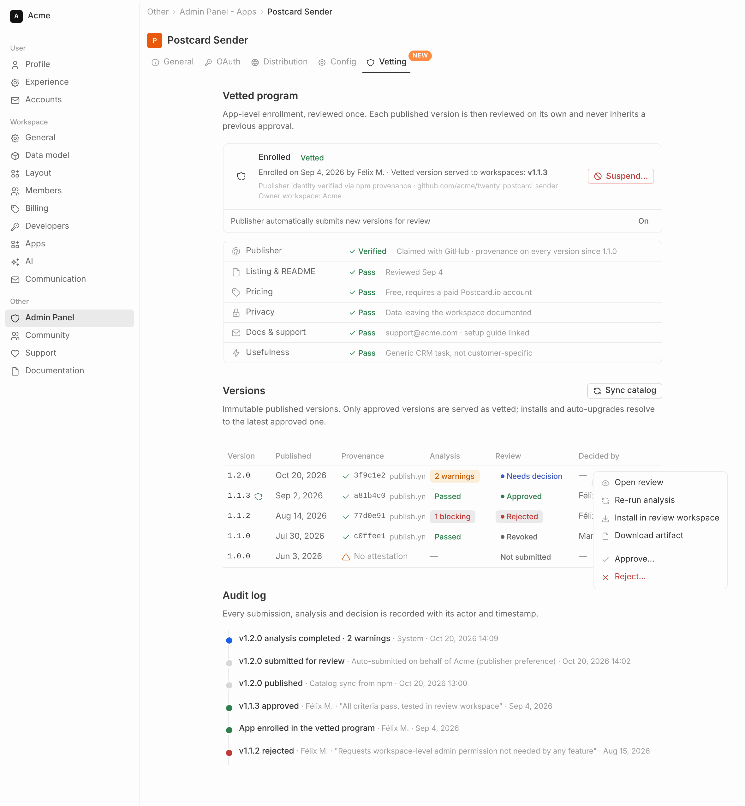
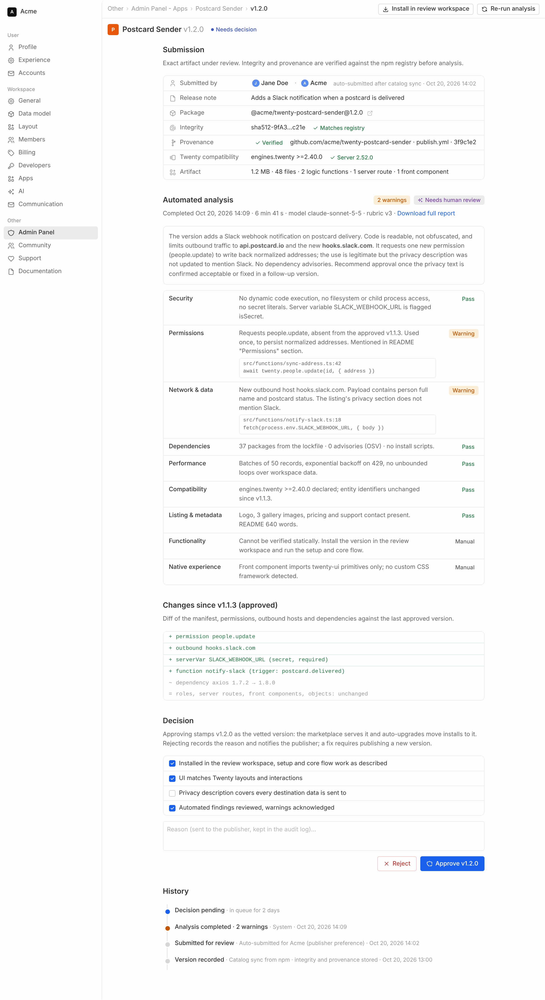
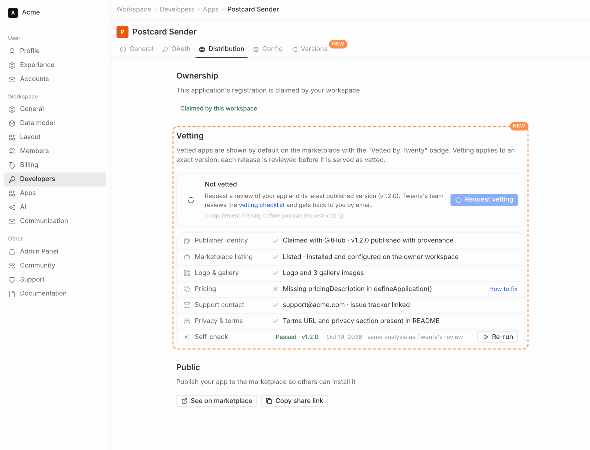
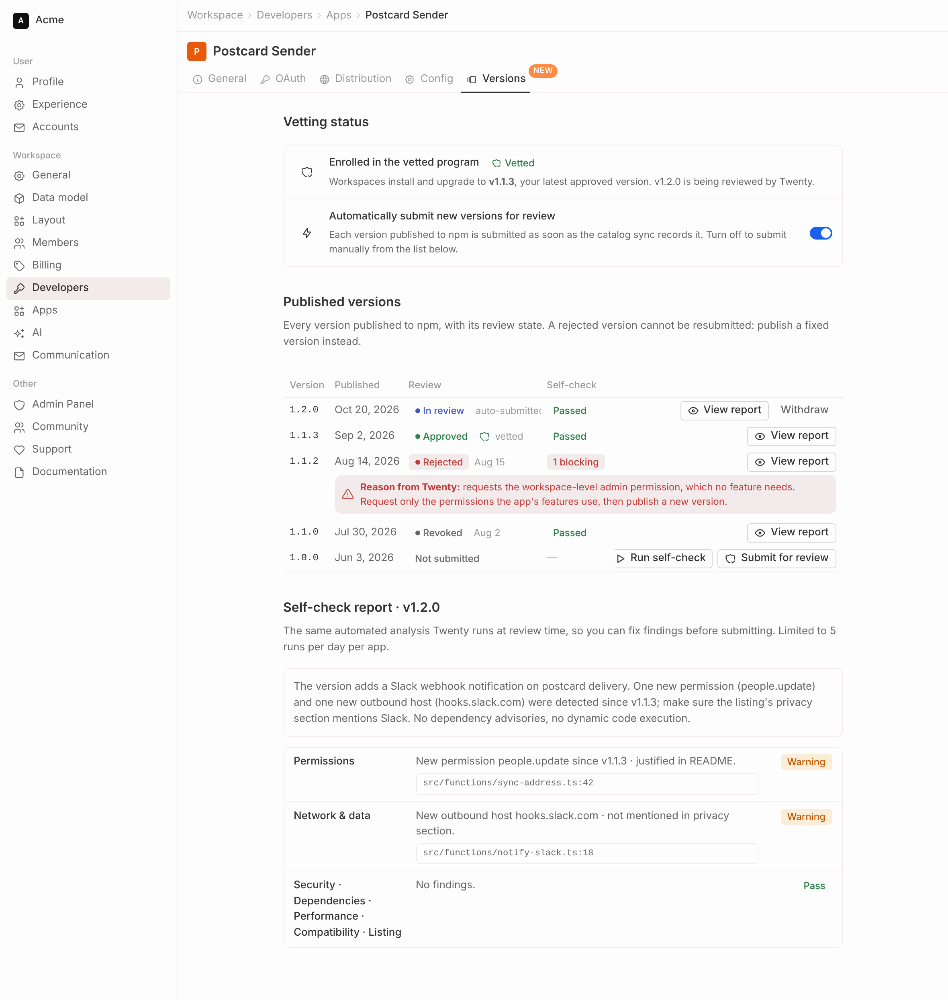
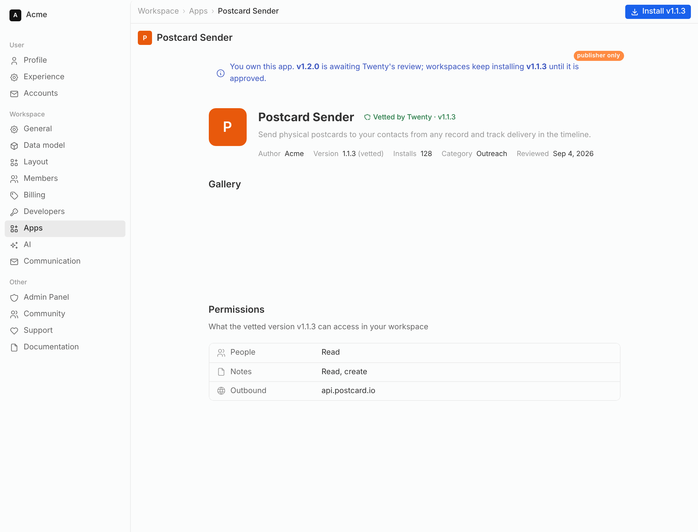

# App vetting review workflow

Design for [core-team-issues#2975](https://github.com/twentyhq/core-team-issues/issues/2975): submit, approve or reject a published app version. It builds on the immutable version records (`core.applicationRegistrationVersion`) and the [vetting checklist](../../twenty-docs/developers/extend/apps/operations/marketplace-vetting.mdx).

The images in `app-vetting-review/` are design mockups, not screenshots of shipped UI.

## Principles

- The vetted designation belongs to an exact published version. A new release never inherits it.
- Two kinds of requests: an app enrolls once in the vetted program (app-level criteria), then every published version is reviewed on its own (version-level criteria).
- Automated analysis prepares every decision; a server admin stamps it. Nothing is approved without a human.
- Every submission, analysis, decision and revocation is an audit event with actor, timestamp and reason.
- The marketplace serves the latest approved version compatible with the server, never the latest published one (issue 2976).

## Workflows

## Data model

| Change | Purpose |
| --- | --- |
| `applicationRegistration.vettingStatus` (`NOT_ENROLLED`, `ENROLLMENT_REQUESTED`, `ENROLLED`, `DECLINED`, `SUSPENDED`) | Replaces the `isVetted` boolean as source of truth. `isVetted` stays as a derived GraphQL field: enrolled and at least one approved version compatible with the server. |
| `applicationRegistration.autoSubmitNewVersions` | Publisher preference, default `true` once enrolled. |
| `applicationRegistrationVersion.integrity`, `.provenance` | sha512 from the registry (or computed for tarballs) and the attestation facts (repository, workflow, commit). |
| `applicationRegistrationVettingRequest` | One row per enrollment request: requester, workspace, message, status, decision, reason, app-level checklist. |
| `applicationRegistrationVersionReview` | One row per submission of a version: submitter, note, status (`SUBMITTED`, `ANALYZING`, `NEEDS_DECISION`, `APPROVED`, `REJECTED`, `REVOKED`, `WITHDRAWN`, `ANALYSIS_FAILED`), decision, reason, manual checklist, revocation. At most one active review per version. |
| `applicationRegistrationVersionAnalysis` | One row per analysis run: trigger (system, admin, publisher), status, artifact integrity analyzed, provenance verified, model, rubric version, summary, recommendation, findings, permission diff, scanner outputs. Immutable once completed. |
| `applicationReviewEvent` | Audit trail of every transition: subject, event, actor type and id, reason, timestamp. |

Legacy data: registrations with `isVetted = true` are migrated to `ENROLLED`, and their current `latestAvailableVersion` gets an `APPROVED` review by `SYSTEM` so the marketplace keeps serving them. `MARKETPLACE_VETTED_APPLICATIONS` only keeps its ordering role.

## Automated analysis

A worker job runs the same pipeline for a submission, an admin re-run and a publisher self-check:

1. Fetch the exact artifact, check its sha512 against the registry integrity, verify the sigstore attestation and that its repository matches the claimed GitHub repository.
2. Unpack without executing anything: package.json, lockfile, manifest, bundled sources.
3. Deterministic scanners: manifest and permission audit, permission diff against the last approved version, dependency advisories, static scan for outbound hosts, dynamic code execution, filesystem and process access, secret patterns and obfuscation, listing completeness.
4. Agent review with the instance AI provider (Admin Panel > AI), the vetting checklist as rubric, read-only tools over the unpacked artifact and the scanner outputs, and a JSON-schema output with per-criterion verdicts and evidence.
5. Report stored on the analysis record: `PASS`, `WARN`, `FAIL` or `MANUAL` per criterion with evidence, a summary, a recommendation, and the model and rubric version so the result is reproducible. A `FAIL` on security, integrity or provenance is blocking.

The review moves to `NEEDS_DECISION` when the report is stored, or to `ANALYSIS_FAILED` when the job errors.

## Admin experience

Admin Panel > Apps gets a review queue above the registrations table. The Vetted column shows the approved version, a pending request or a suspension.

The app detail page gets a Vetting tab that replaces the Vetted switch of the General tab: enrollment status and app-level checklist, the versions table with provenance, analysis and review state, and the audit log.

A version review page shows the submission facts, the automated report, the changes since the last approved version, the decision form and the history.

## Publisher experience

Settings > Developers > Apps > My apps > app > Distribution gets a Vetting section with the pre-flight checklist and the request button. A self-check runs the same analysis before submitting.

A Versions tab lists every published version with its review state, the reason of a rejection, the auto-submit preference and the self-check report.

## Marketplace

The badge reads "Vetted by Twenty" with the approved version. Install and upgrade resolve to that version. The owner workspace sees a note when a newer version is awaiting review.

## API surface

Publisher (metadata API, owner workspace, Developers permission): `requestApplicationVetting`, `withdrawApplicationVettingRequest`, `submitApplicationVersionForReview`, `withdrawApplicationVersionReview`, `runApplicationVersionSelfCheck` (rate-limited), `updateApplicationRegistration({ autoSubmitNewVersions })`, `applicationRegistrationVersions` with review state and report.

Admin (admin API, `canAccessFullAdminPanel`): `findAdminApplicationReviewQueue`, `findAdminApplicationRegistrationVersions`, `findAdminApplicationVersionReview`, `decideApplicationVettingRequest`, `decideApplicationVersionReview`, `revokeApplicationVersionApproval`, `suspendApplicationVetting`, `reinstateApplicationVetting`, `runApplicationVersionAnalysis`.

Jobs and hooks: `ApplicationVersionAnalysisJob`; catalog sync and tarball publish create a review for enrolled apps with auto-submit on; decisions invalidate the marketplace catalog cache; emails to the publisher on decision and to admins on new requests.
