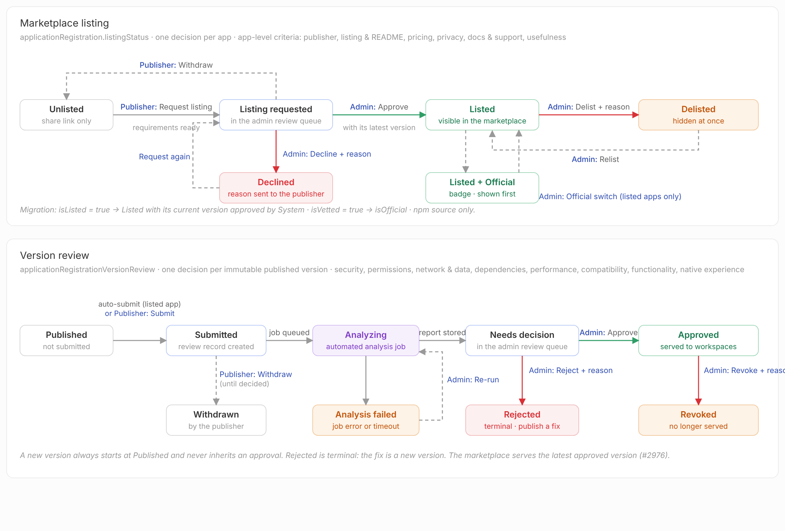
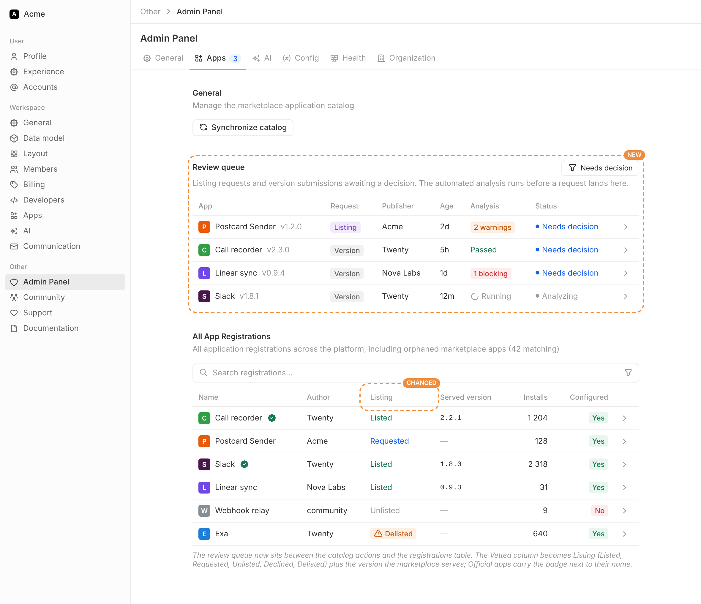
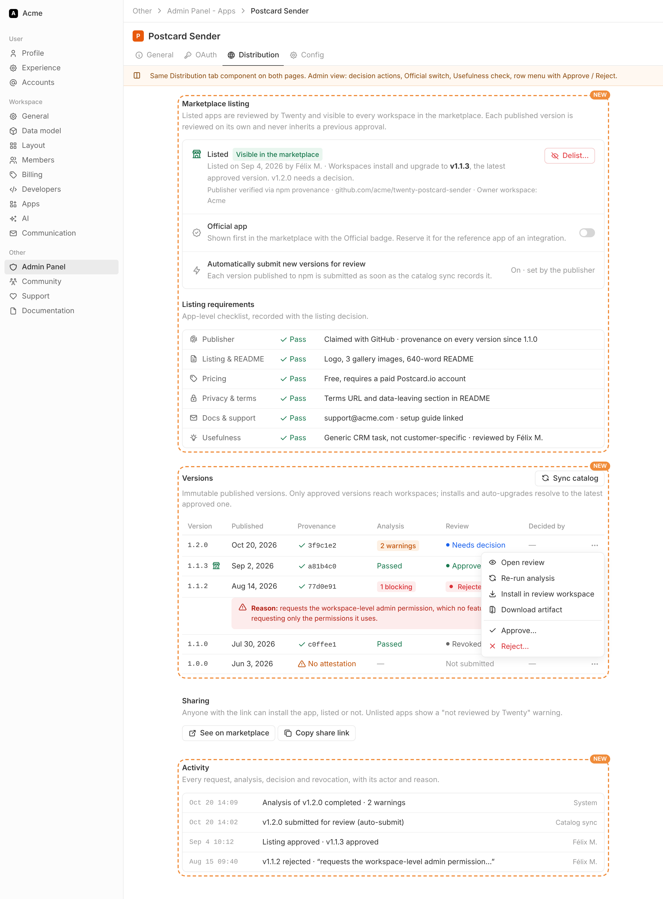
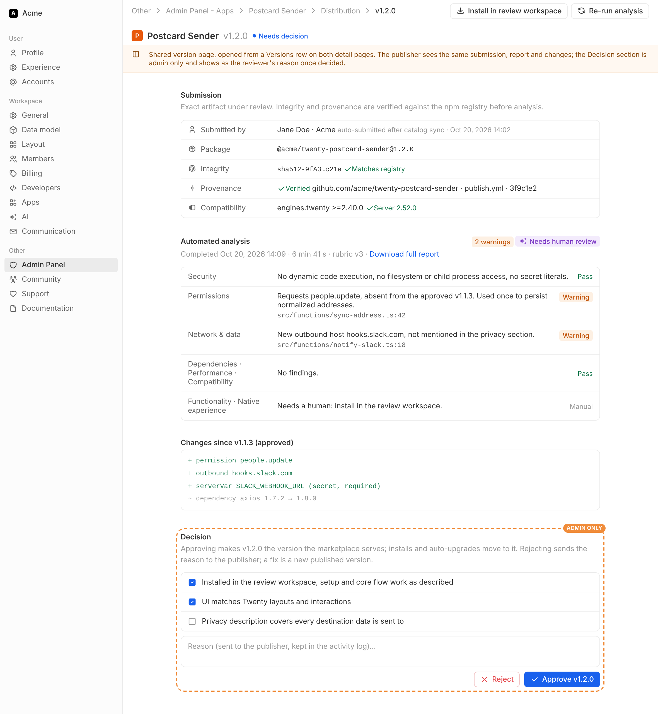
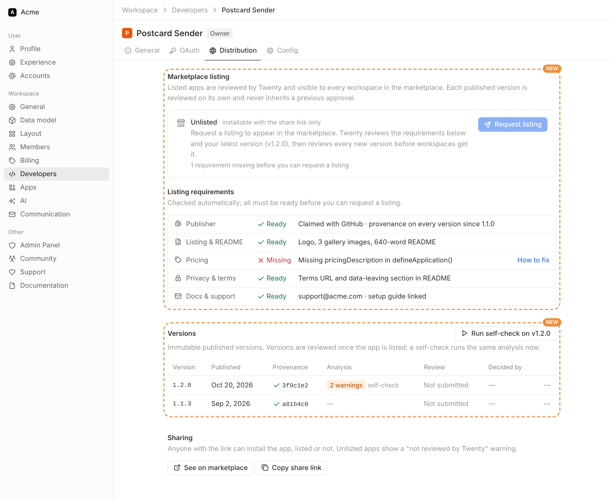
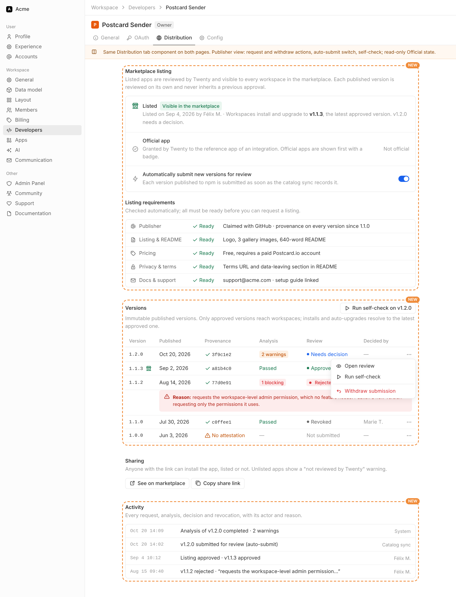
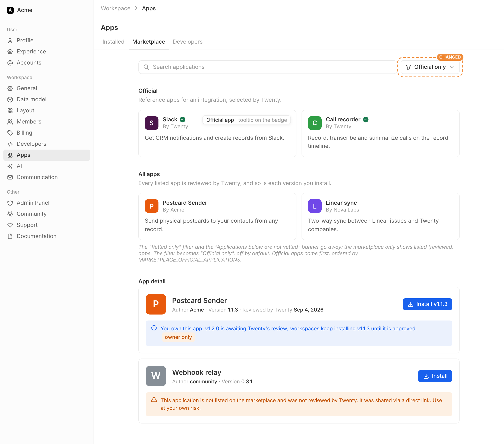
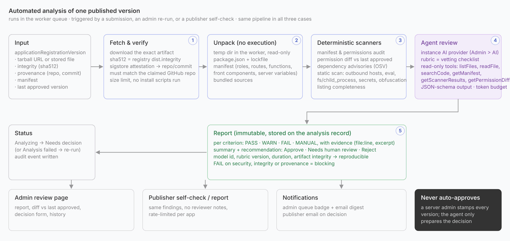

# App listing and version review

Design for [core-team-issues#2975](https://github.com/twentyhq/core-team-issues/issues/2975): submit, approve or reject a published app version. It builds on the immutable version records (`core.applicationRegistrationVersion`) and the [vetting checklist](../../twenty-docs/developers/extend/apps/operations/marketplace-vetting.mdx).

The images in `app-vetting-review/` are design mockups, not screenshots of shipped UI.

## Principles

- Every app in the marketplace is reviewed by Twenty. **Listed** means reviewed and visible to every workspace. There is no unreviewed tier inside the marketplace.
- **Official** is a badge on top of a listed app: the reference app for an integration (one official Slack app, one official WhatsApp app). An admin grants it; it replaces today's `isVetted`.
- Listing is decided once per app (app-level criteria). Every published version of a listed app is then reviewed on its own (version-level criteria) and never inherits a previous approval.
- Automated analysis prepares every decision; a server admin stamps it. Nothing is approved without a human.
- The marketplace serves the latest approved version compatible with the server, never the latest published one (issue 2976).
- Unlisted apps stay installable with a share link, behind a "not reviewed by Twenty" warning.
- The admin and publisher app pages share one Distribution tab and one version page; only the actions differ.

## Naming

| Today | New | Meaning |
| --- | --- | --- |
| `isListed` (admin switch "Allow installation") | `listingStatus`: `UNLISTED`, `LISTING_REQUESTED`, `LISTED`, `DECLINED`, `DELISTED` | Reviewed and visible in the marketplace. |
| `isVetted` (admin switch "Vetted") | `isOfficial` | Official badge, shown first. Only on listed apps. |
| `MARKETPLACE_VETTED_APPLICATIONS` | `MARKETPLACE_OFFICIAL_APPLICATIONS` | Seeds `isOfficial` and orders official apps. |
| "Vetted only" filter, "not vetted" banners | "Official only" filter (off by default); "not reviewed by Twenty" banner on unlisted apps | |

"Vetting" stays the name of the review process in docs; it is no longer a status.

## Workflows

End to end:

1. The publisher runs `twenty app publish` from CI; npm stores the package with its provenance attestation.
2. The catalog sync records the version with its sha512 integrity and provenance.
3. If the app is listed and auto-submit is on, a review is created; otherwise the publisher submits from the Versions table.
4. The analysis job verifies the artifact, runs the scanners and the agent review, and stores the report. The review moves to "Needs decision" and appears in the admin review queue.
5. An admin approves or rejects with a reason. Approval refreshes the catalog cache, and installs and auto-upgrades move to that version.
6. The publisher gets the decision and the reason by email and in the Versions table. A rejected version is final: the fix is a new version, which starts again at step 2.

## Admin experience

Admin Panel > Apps: the review queue sits between the catalog actions and the registrations table. The Vetted column becomes Listing (status) plus the served version, and official apps carry the badge next to their name.

App detail > Distribution: the listing card (approve, decline, delist with a reason), the Official switch, the listing requirements with the reviewer's verdicts, the versions table with row actions, sharing and the activity log. The "Allow installation" and "Vetted" switches leave the General tab; "Pre-install on new workspaces" stays there.

The version page, opened from a Versions row, shows the submission facts, the automated report, the changes since the last approved version and, for admins only, the decision form.

## Publisher experience

Settings > Developers > app > Distribution: the same tab. An unlisted app shows the listing requirements, checked automatically, and the "Request listing" button, which stays disabled until they are all ready. Versions can be self-checked before the request.

Once the app is listed, the publisher sees the same listing card (with a read-only Official state), the auto-submit switch, the versions with each rejection's reason, and the activity log. The row menu offers "Open review", "Run self-check" and "Withdraw submission".

## Marketplace

All listed apps show without a filter. Official apps come first with a badge ("Official app" tooltip). Install and upgrade resolve to the latest approved version. The owner workspace sees a note when a newer version awaits review. A shared link to an unlisted app shows a warning.

## Data model

| Change | Purpose |
| --- | --- |
| `applicationRegistration.listingStatus` | Replaces `isListed`. The catalog query filters on `LISTED`. |
| `applicationRegistration.isOfficial` | Replaces `isVetted`. A validation rejects it unless the app is `LISTED`. |
| `applicationRegistration.autoSubmitNewVersions` | Publisher preference, default `true` once listed. |
| `applicationRegistrationVersion.integrity`, `.provenance` | sha512 from the registry (or computed for tarballs) and the attestation facts (repository, workflow, commit). |
| `applicationRegistrationListingRequest` | One row per listing request: requester, workspace, message, status, decision, reason, app-level checklist. |
| `applicationRegistrationVersionReview` | One row per submission of a version: submitter, note, status (`SUBMITTED`, `ANALYZING`, `NEEDS_DECISION`, `APPROVED`, `REJECTED`, `REVOKED`, `WITHDRAWN`, `ANALYSIS_FAILED`), decision, reason, manual checklist, revocation. At most one active review per version. |
| `applicationRegistrationVersionAnalysis` | One row per analysis run: trigger (system, admin, publisher), status, artifact integrity analyzed, provenance verified, model, rubric version, summary, recommendation, findings, permission diff, scanner outputs. Immutable once completed. |
| `applicationReviewEvent` | Activity log of every transition: subject, event, actor type and id, reason, timestamp. |

Legacy data: `isListed = true` becomes `LISTED`, with the current `latestAvailableVersion` approved by `SYSTEM` so the marketplace keeps serving it. `isVetted = true` becomes `isOfficial = true`. Only npm-sourced apps can be listed, as today.

## Automated analysis

A worker job runs the same pipeline for a submission, an admin re-run and a publisher self-check:

1. Fetch the exact artifact, check its sha512 against the registry integrity, verify the sigstore attestation and that its repository matches the claimed GitHub repository.
2. Unpack without executing anything: package.json, lockfile, manifest, bundled sources.
3. Deterministic scanners: manifest and permission audit, permission diff against the last approved version, dependency advisories, static scan for outbound hosts, dynamic code execution, filesystem and process access, secret patterns and obfuscation, listing completeness.
4. Agent review with the instance AI provider (Admin Panel > AI), the vetting checklist as rubric, read-only tools over the unpacked artifact and the scanner outputs, and a JSON-schema output with per-criterion verdicts and evidence.
5. Report stored on the analysis record: `PASS`, `WARN`, `FAIL` or `MANUAL` per criterion with evidence, a summary, a recommendation, and the model and rubric version so the result is reproducible. A `FAIL` on security, integrity or provenance is blocking.

The review moves to `NEEDS_DECISION` when the report is stored, or to `ANALYSIS_FAILED` when the job errors.

## API surface

Publisher (metadata API, owner workspace, Developers permission): `requestApplicationListing`, `withdrawApplicationListingRequest`, `submitApplicationVersionForReview`, `withdrawApplicationVersionReview`, `runApplicationVersionSelfCheck` (rate-limited), `updateApplicationRegistration({ autoSubmitNewVersions })`, `applicationRegistrationVersions` with review state and report.

Admin (admin API, `canAccessFullAdminPanel`): `findAdminApplicationReviewQueue`, `findAdminApplicationRegistrationVersions`, `findAdminApplicationVersionReview`, `decideApplicationListingRequest`, `delistApplication`, `relistApplication`, `decideApplicationVersionReview`, `revokeApplicationVersionApproval`, `runApplicationVersionAnalysis`. `AdminUpdateApplicationRegistrationPayload` swaps `isListed` and `isVetted` for `isOfficial`.

Both pages read the same `applicationRegistrationVersions` shape; the admin resolver adds reviewer notes and the decision fields.

Jobs and hooks: `ApplicationVersionAnalysisJob`; catalog sync and tarball publish create a review for listed apps with auto-submit on; decisions invalidate the marketplace catalog cache; emails to the publisher on decision and to admins on new requests.
